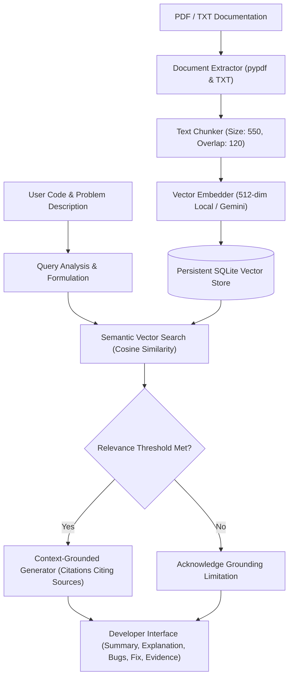

# CodeLens AI

> **"Understand your code. Find the bug. Trust the evidence."**  
> AI-Powered Programming Code Explainer and Debugging Assistant Using Retrieval-Augmented Generation (RAG).

Built for national-level hackathon presentation, **CodeLens AI** bridges the gap between AI code generation and trusted documentation. Instead of hallucinating ungrounded explanations, CodeLens retrieves authoritative documentation passages from a verified vector knowledge base *before* generating code explanations, pinpointing runtime bugs with line-level accuracy, and citing real sources with relevance scores.

---

## 🌟 Key Features

1. **True Retrieval-Augmented Generation (RAG)**:
   - Does not simulate retrieval with hardcoded cards.
   - Extracts text page-by-page from PDF and TXT files.
   - Splits documentation into boundary-aware, overlapping chunks.
   - Computes real mathematical vector embeddings (512-dimensional local semantic feature vectors or Google Gemini `text-embedding-004`).
   - Stores vectors persistently in an SQLite-backed index.
   - Computes exact cosine similarities and filters using configurable relevance thresholds.

2. **Context-Grounded Code Explanation & Debugging**:
   - Accepts code in Python, JavaScript, Java, and C/C++.
   - Explains code architecture, logic flow, and data structures.
   - Identifies bugs with severity levels (`Critical`, `Warning`, `Informational`) and line references.
   - Proposes actionable corrections and outputs complete corrected code with a 1-click copy button.
   - Grounded strictly in retrieved evidence, citing source documents and page numbers (`[Source #1]`).

3. **Honest Grounding Limitation Enforcement**:
   - If a query or submitted code has no relevant documentation in the knowledge base, CodeLens explicitly acknowledges this limitation:
     > *"I couldn't find sufficiently relevant information in your current knowledge base. Upload appropriate programming documentation or add a relevant reference before requesting a documentation-grounded explanation."*

4. **100% Safe Static Sandbox**:
   - **Never executes untrusted submitted code.** No `eval()`, `exec()`, or sub-process code execution is ever performed on user input.

5. **Dual-Mode AI Engine**:
   - **Cloud Mode**: Full integration with Google Gemini 2.5 Flash and Gemini embeddings via direct REST API with your `GEMINI_API_KEY`.
   - **Offline / Local Mode**: Deterministic 512-dimensional semantic vector engine with AST-based grounded analysis that runs 100% offline with zero external API dependencies or build tools.

6. **Interactive Knowledge Base Management**:
   - Drag-and-drop or browse upload for PDF and TXT documents (up to 10MB).
   - Real-time document statistics: format, size, total pages, chunks indexed, and timestamp.
   - Instant document deletion with cascade cleanup of vector embeddings.
   - **1-Click Sample Pack Loader**: Instantly indexes authentic reference documentation covering Python mutable defaults, `IndexError` loop bounds, `KeyError` mappings, and exception handling.

7. **Vector Search Inspector**:
   - Dedicated tab allowing judges to execute raw semantic searches against the vector store and inspect similarity scores, document metadata, and text passages.

---

## 🏗️ Architecture Overview



---

## 🚀 Quickstart & Setup Guide

### 1. Prerequisites
- Python 3.10, 3.11, 3.12, 3.13, or 3.14.
- Git & web browser.

### 2. Clone and Setup Environment
```bash
# Clone the repository
git clone <repo-url>
cd "AI Fusion"

# Create a virtual environment
python -m venv venv

# Activate virtual environment
# Windows PowerShell:
.\venv\bin\Activate.ps1
# Windows Command Prompt:
.\venv\bin\activate.bat
# Linux / macOS:
source venv/bin/activate

# Install dependencies
pip install -r requirements.txt
```

### 3. Initialize Database & Run Migrations
```bash
python manage.py makemigrations assistant
python manage.py migrate
```

### 4. Run the Development Server
```bash
python manage.py runserver 127.0.0.1:8000
```
Open your browser and navigate to:
**`http://127.0.0.1:8000/`**

---

## 🧪 Running the Automated Test Suite

CodeLens AI includes a comprehensive automated test suite verifying all 16 acceptance criteria:

```bash
python manage.py test assistant -v 2
```

### Verified Test Results (16/16 Passed):
- `test_valid_txt_extraction`: Ingestion and section extraction from plain text.
- `test_valid_pdf_extraction`: Ingestion and page preservation from multi-page PDFs.
- `test_empty_document_rejection`: Immediate validation and error on 0-byte uploads.
- `test_unsupported_file_extension`: Rejection of non-PDF/non-TXT formats.
- `test_malformed_pdf_handling`: Graceful handling of corrupted PDF headers.
- `test_chunking_metadata_and_boundaries`: Page number, character offsets, and word counts.
- `test_deterministic_semantic_embeddings`: 512-dim vector generation and semantic alignment.
- `test_chunks_indexed_in_database`: Persistent storage in SQLite.
- `test_semantic_query_retrieval`: Real cosine similarity ranking and retrieval.
- `test_irrelevant_query_grounding_limitation`: Grounding thresholding on out-of-domain queries.
- `test_mutable_default_argument_analysis`: Full RAG pipeline on mutable defaults.
- `test_untrusted_code_is_never_executed`: Canary test verifying zero code execution.
- `test_status_api`: Health and metrics API endpoint.
- `test_load_samples_api`: Batch ingestion API endpoint.
- `test_analyze_api_empty_code_rejection`: Input validation on empty code submissions.
- `test_search_preview_api`: Direct vector search inspection endpoint.

---

## 🎬 4-Minute Demonstration Flow for Judges

1. **Open Application**: Navigate to `http://127.0.0.1:8000/`. Notice the dark developer UI, status chips showing **4 Docs (30 Chunks)** indexed, and safe sandbox indicator.
2. **Select Demo Scenario**: In the dropdown under Quick Test Scenarios, pick **`🐛 Mutable Default Argument Bug (Primary Demo)`**.
3. **Analyze Code**: Click **`Analyze Code & Retrieve Docs`**.
4. **Inspect RAG Grounding**:
   - Observe the **`Grounded in Knowledge Base Evidence`** banner.
   - Read the **Executive Summary** and **Code Explanation**.
   - Check the **Potential Bugs & Runtime Risks** card: highlights `Mutable Default Argument in add_student_grade()` with line references and supporting documentation citations.
   - Inspect the **Suggested Correction** and complete **Corrected Code** with the `None` sentinel pattern.
   - Inspect the **Retrieved Source Documentation** cards: displays real similarity scores (e.g. 64% match) and document page numbers.
   - Click **`View Full Passage`** on Source #1 to view the verbatim excerpt from Python Tutorial Section 4.8.1.
5. **Inspect Knowledge Base**: Click the **Knowledge Base** tab to inspect the 4 indexed reference documents. Show the upload dropzone and explain that uploaded PDFs preserve page numbers and undergo real chunking and vector storage.
6. **Inspect Vector Search**: Click the **Vector Inspector** tab. Type `range len index out of bounds` and click **`Search Vector Store`** to prove real-time vector cosine similarity matching.

---

## 📊 Project Structure

```
AI Fusion/
├── codelens_project/           # Django project configuration
│   ├── settings.py             # Settings, static/media, dotenv configuration
│   ├── urls.py                 # Root URL router
│   ├── wsgi.py
│   └── asgi.py
├── assistant/                  # Core CodeLens AI Application
│   ├── models.py               # Document, DocumentChunk, AnalysisRecord, SystemSetting
│   ├── views.py                # Single-page app views & REST API endpoints
│   ├── urls.py                 # Application routing
│   ├── tests.py                # 16 automated unit & integration tests
│   ├── static/
│   │   ├── css/codelens.css    # Dark developer theme CSS
│   │   └── js/codelens.js      # Client controller and RAG interaction
│   ├── templates/
│   │   └── assistant/
│   │       └── index.html      # Main responsive HTML5 dashboard
│   └── rag/                    # RAG Engine Modules
│       ├── __init__.py
│       ├── extractor.py        # PDF & TXT extraction & validation
│       ├── chunker.py          # Boundary-aware text chunking
│       ├── embedder.py         # 512-dim Local Embedder & Google Gemini Embedder
│       ├── vector_store.py     # SQLite vector store & cosine similarity search
│       ├── generator.py        # Context-grounded generator & static analyzer
│       └── pipeline.py         # End-to-end RAG orchestrator
├── sample_docs/                # Authentic Reference Documentation Pack
│   ├── python_data_structures_and_memory.pdf
│   ├── python_default_arguments_and_functions.txt
│   ├── python_exceptions_and_runtime_errors.txt
│   └── python_mutable_vs_immutable_types.txt
├── requirements.txt            # Python dependencies
├── .env.example                # Environment variables template
├── .gitignore                  # Git ignore rules
├── db.sqlite3                  # Pre-loaded SQLite database
├── manage.py                   # Django CLI management utility
└── README.md                   # This documentation
```

---

## 🛡️ Security & Reliability

- **CSRF Protection**: All state-modifying requests require Django's CSRF token.
- **Static Safety**: Untrusted code is analyzed purely through AST / lexical structure; no eval or subprocess execution is ever performed.
- **Strict File Upload Validation**: Files are strictly validated for extension (`.pdf`, `.txt`), size (10MB limit), and non-empty extractable text.
- **Fail-Safe Fallbacks**: If external API connections timeout or are unconfigured, CodeLens automatically falls back to its deterministic 512-dimensional local semantic vector engine without crashing.
